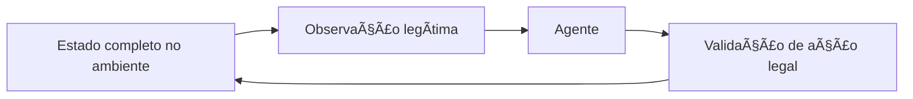

# TrucoAI — pesquisa em Truco Paulista 1v1

Pesquisa experimental sobre agentes de informação imperfeita para Truco Paulista com dois jogadores individuais. Inclui motor de regras, observações por jogador, MCCFR, busca, políticas neurais e avaliação contra bots. A PlayTruco é a referência de modalidade; este projeto é independente, sem afiliação declarada com a plataforma.

**Status: pesquisa em andamento, sem revisão por pares.** Os resultados publicados são de simulação. Não demonstram força contra humanos, equilíbrio de Nash, optimalidade ou fidelidade integral ao site.

## Resultado selecionado: E13

No painel fixo de sete adversários, E13 venceu **363/560 partidas (64,82%)**, contra **319/560 (56,96%)** do controle E9. Ganho pareado: **7,86 pontos percentuais**, IC normal de 95% **[2,02; 13,70]**. Houve 1.120 partidas principais e 160 exploratórias, com posições espelhadas e sementes comuns aos candidatos.

E13 fez **47,5% contra Zap v1**: a média do painel não implica vencer cada adversário. Tempo médio registrado: 0,302 s por decisão; máximo observado: 0,938 s. As latências dependem da máquina e do protocolo. [Método, tabela completa e limites](docs/RESEARCH.md).

## Executar localmente

Python 3.10 ou superior; use um ambiente virtual.

```bash
python -m venv .venv
# Windows: .venv\Scripts\activate
# Linux/macOS: source .venv/bin/activate
python -m pip install -e ".[dev,learned]"
python -m pytest -q
python scripts/audit_e13.py
python scripts/evaluate.py --agents random heuristic --deals 20 --workers 1 --tag local
python scripts/play_cli.py --agent heuristic
```

Os dois últimos comandos usam o padrão histórico `h0`; não reproduzem o E13/O1. Para criar um blueprint novo sob O1:

```bash
python scripts/train_mccfr.py --help
python scripts/train_mccfr_rs.py --help
```

Treinar redes exige o extra `training`; CUDA e compilador Rust são opcionais. Os testes dependentes de blueprints históricos ficam explicitamente ignorados quando esses artefatos estão ausentes. Veja [reprodução](docs/REPRODUCIBILITY.md).

## Conteúdo e fronteiras

- `trucoai/`: regras, observação legítima, agentes, treino e componentes de integração.
- `tests/`: testes locais; não incluem capturas de participantes.
- `rust/mccfr/`: fonte do núcleo de treino; sem binários pré-compilados.
- `runs/*/policy.npz`: pesos produzidos pelos experimentos locais; não incluem checkpoints de terceiros.
- `research/e13/`: exportação dos recibos de simulação, com caminhos locais removidos e manifesto de transformação.



O regulamento O1 e suas hipóteses estão em [REGRAS.md](docs/REGRAS.md). Relatos históricos de observação do site não são uma verificação atual. Esta distribuição não inclui perfil de navegador, sessões autenticadas, capturas reais, dados de participantes nem launcher de jogo no site. A integração completa com humanos permanece fora da validação desta publicação.

[Proveniência e direitos](docs/PROVENANCE.md) · [Privacidade](docs/PRIVACY.md) · [Preparação para publicação](docs/PUBLICATION.md)
